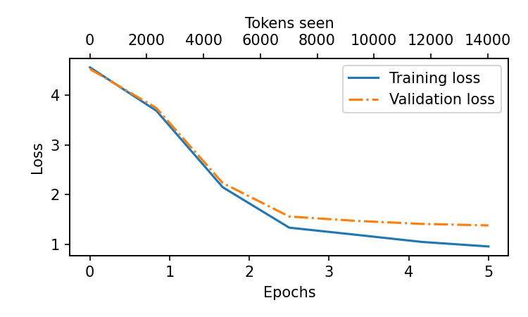

# ICTSahayi

An FAQ chatbot for [ICT Academy of Kerala](https://ictkerala.org) (ICTAK), built by instruction fine-tuning GPT-2 small (124M parameters) on question-and-answer pairs about the academy's courses, fees, scholarships and policies.

This is a learning project. I implemented the GPT-2 model, weight loading and training loop in plain PyTorch so I understood every part, instead of calling a fine-tuning library.

## What's in the repo

| Path | What it does |
| --- | --- |
| `data/instruction_faq.json` | 62 FAQ pairs in instruction format (`instruction`, `input`, `output`), written from ICTAK's public information |
| `data/paraphrased_questions.json` | 20 FAQ questions asked in different words, to test whether the model handles new phrasing |
| `finetune.py` | Loads OpenAI's pretrained GPT-2 weights and instruction fine-tunes them |
| `evaluate.py` | Scores the base model, the fine-tuned model and a retrieval baseline |
| `infer.py` | Ask the fine-tuned model a question |
| `run_on_kaggle.ipynb` | Runs training and evaluation end to end on a free Kaggle GPU |
| `src/` | GPT-2 model, weight loader, dataset, training loop |

## How it works

1. **Data.** Each FAQ pair is formatted as an Alpaca-style prompt (`### Instruction:` / `### Response:`). The data is shuffled with a fixed seed and split 85 / 10 / 5 into train (52), test (6) and validation (4).
2. **Model.** GPT-2 small with OpenAI's pretrained weights, loaded into the PyTorch implementation in `src/`.
3. **Training.** Full fine-tuning with AdamW (learning rate 5e-5, weight decay 0.1, batch size 8, 5 epochs). Before training, the script checks the starting loss to confirm the pretrained weights really loaded.
4. **Evaluation.** Answers are scored against the reference answer with ROUGE-L F1. The fine-tuned model is compared with base GPT-2 and with a retrieval baseline that simply returns the stored answer of the most similar training question.

## Results

Run on a Kaggle GPU, October 2026. Training took about 7 seconds.



**Loss:** training 4.56 → 0.96, validation 4.53 → 1.38 over 5 epochs. A starting loss of 4.56 confirms the pretrained weights loaded. (The buggy first version started from a random model, near 10.8.)

**Answer quality**, mean ROUGE-L F1 against the reference answer (0 to 1, higher is better):

| System | Held-out questions (n=6) | Reworded, original was in training (n=16) | Reworded, original was held out (n=4) |
| --- | --- | --- | --- |
| Retrieval baseline (word overlap, no model) | 0.13 | 0.31 | 0.14 |
| GPT-2 base, not fine-tuned | 0.15 | 0.09 | 0.13 |
| GPT-2 fine-tuned | 0.18 | 0.21 | 0.26 |

**What this shows:**

- **Fine-tuning taught the format.** The base model rambles, repeats itself and drifts into C code. The fine-tuned model gives short, on-topic answers in the FAQ's style and stops cleanly.
- **It did not learn the facts.** Reading all 26 answers, only about 2 are right in substance. The rest are fluent and confident but wrong. It says the main office is "in the central district of Delhi", that long-term programmes last "around five years", that "online courses are not available", and that marks are deducted for wrong answers.
- **ROUGE-L hides this.** "Long-term programmes typically last around five years" scored 0.50 against the correct "around 6 months", because the wording overlaps. Word overlap is not correctness, so the next version needs a metric that checks facts.
- **62 examples is far too few to store facts in model weights.** This is the case for retrieval: keep the facts in a searchable store and let the model phrase them.

Every question, reference and model answer is in [`results/eval_results.json`](results/eval_results.json). The summary is in [`results/eval_summary.md`](results/eval_summary.md), and the training settings in [`results/train_log.json`](results/train_log.json). With 6 to 16 questions per set, treat these as rough signals.

## Run it

On Kaggle (recommended): open `run_on_kaggle.ipynb`, turn on a GPU and internet, and run all cells. Training takes a few minutes.

Locally:

```bash
pip install -r requirements.txt
python finetune.py          # downloads GPT-2 weights, trains, saves model_tuned/
python evaluate.py          # writes results/eval_summary.md
python infer.py --question "Is there an age limit to apply?"
```

## Changelog

**October 2026: fixed a training bug.** The first version of `finetune.py` loaded the pretrained GPT-2 weights into one model, then created and trained a second, randomly initialised model. So the saved model was trained from scratch on 52 examples, not fine-tuned. The loss curve showed it: the first logged training loss was near 7, while the pretrained model starts at about 4.5 on this data. This version:

- fine-tunes the model that holds the pretrained weights, with a lower learning rate (5e-5 instead of 4e-4)
- fails loudly if the starting loss looks like a random model
- uses the correct `qkv_bias=True` setting for the OpenAI weights in both training and inference
- shuffles before splitting, with the same seed in every script
- adds `evaluate.py` with a base-model and retrieval comparison, and a reworded-question test set
- fixes a stray character in one answer, fills in `requirements.txt` and saves a training log

## Limitations

- **62 examples is very little data.** The model learns the answer style and some facts, but it can confidently produce wrong answers for questions that differ from the training data.
- **Facts go stale.** Fees, dates and policies change. Facts stored in model weights need retraining to update.
- **Small test set.** Six held-out questions plus 20 reworded ones give a rough signal, not a precise measurement.
- **English only.**

## What I would do today

For a production FAQ assistant I would use retrieval-augmented generation: keep the official FAQ and course pages in a search index, retrieve the relevant passage, and have a small open instruction model (for example Qwen2.5 1.5B with Ollama or vLLM) phrase the answer from it. If nothing relevant is found, it should say "I don't know, please contact the office" instead of guessing. Fine-tuning, for example with LoRA, would then only be needed to adjust tone or format, not to store facts.

## Credits

The GPT-2 implementation in `src/` (model, weight download and loading, instruction dataset and training loop) follows Sebastian Raschka's book [*Build a Large Language Model (From Scratch)*](https://github.com/rasbt/LLMs-from-scratch). The FAQ data and evaluation are my own.

## License

MIT
